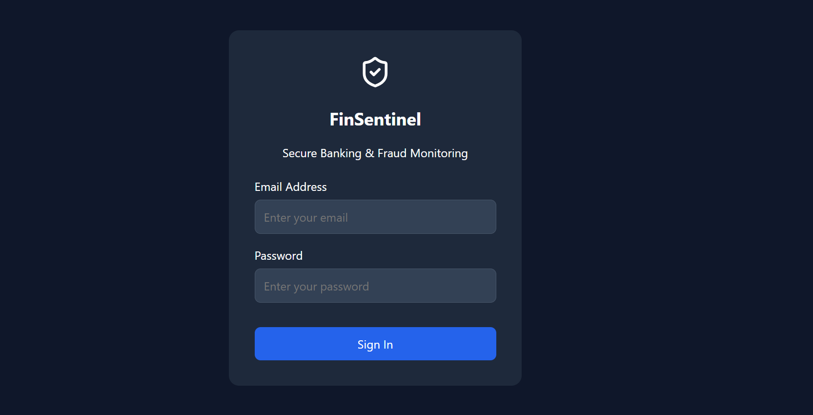
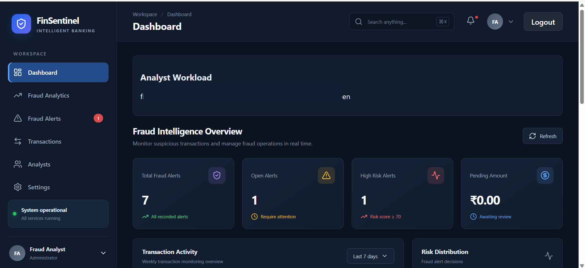
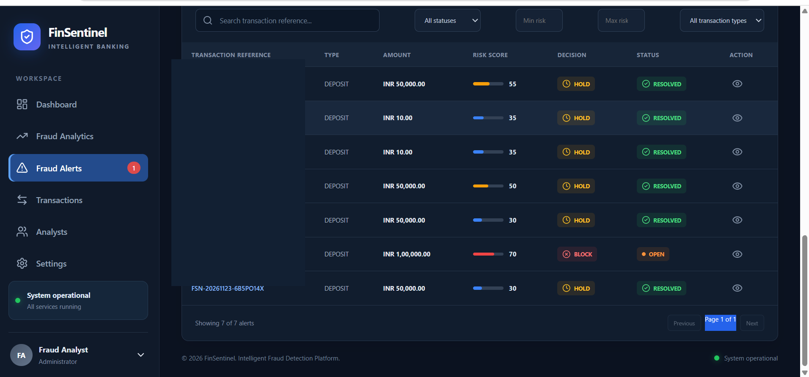
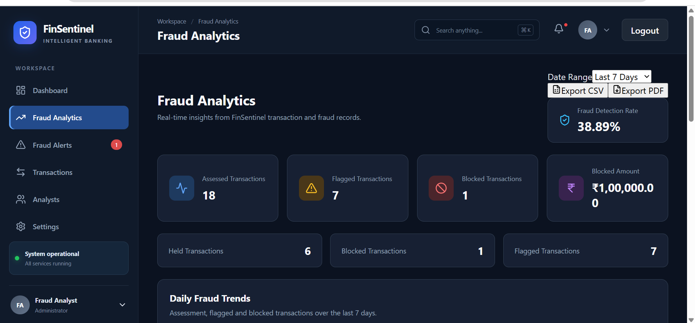
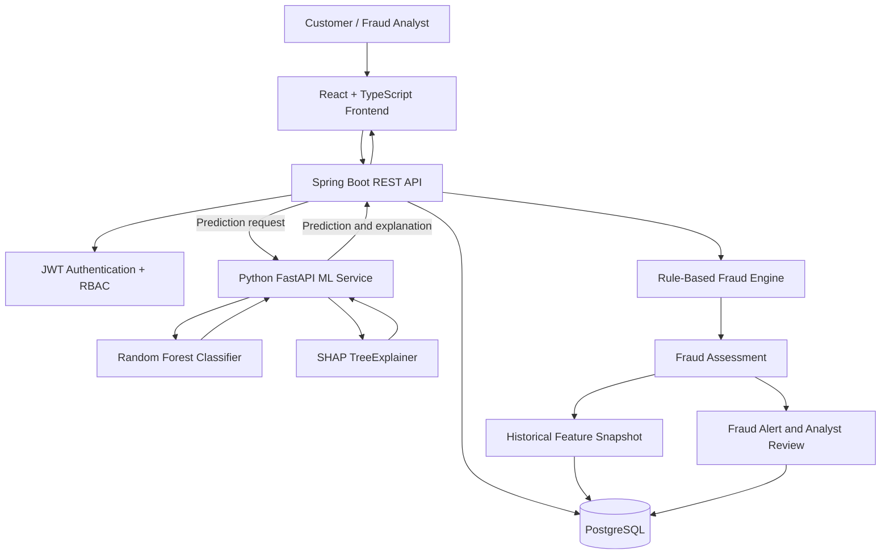

# FinSentinel — Intelligent Digital Banking & Fraud Detection Platform

<p align="center">
  <strong>A full-stack digital banking simulation combining rule-based fraud detection, machine learning, explainable AI, and a human-in-the-loop analyst workflow.</strong>
</p>

<p align="center">
  
  
  
  
  
  
</p>

> **Project status:** Core banking simulation, fraud-rule engine, analyst workflow, ML integration, SHAP explainability, and historical feature snapshots are implemented. Model improvement, expanded automated integration testing, container orchestration, and deployment remain ongoing.
>
> **Important:** FinSentinel is an educational portfolio project. Transactions are simulated. The ML model uses synthetic data and is not validated for real banking or production fraud decisions.

---

## Table of Contents

- [Overview](#overview)
- [Screenshots](#screenshots)
- [Key Features](#key-features)
- [Architecture](#architecture)
- [Technology Stack](#technology-stack)
- [Fraud Detection Approach](#fraud-detection-approach)
- [Machine Learning and Explainable AI](#machine-learning-and-explainable-ai)
- [Model Evaluation](#model-evaluation)
- [Project Structure](#project-structure)
- [Run Locally](#run-locally)
- [API and Service URLs](#api-and-service-urls)
- [Testing](#testing)
- [Security and Limitations](#security-and-limitations)
- [Roadmap](#roadmap)
- [Author](#author)

---

## Overview

FinSentinel is a full-stack digital banking simulation designed to demonstrate how banking applications can combine account operations, transaction monitoring, machine learning, and human-assisted fraud investigation.

The platform consists of three main applications:

1. **React frontend:** Customer banking interface and fraud analyst dashboard.
2. **Spring Boot backend:** Authentication, banking operations, database persistence, authorization, fraud assessment, and analyst workflows.
3. **Python ML service:** FastAPI-based machine learning service providing fraud predictions and SHAP explanations.

The system combines deterministic fraud rules with an experimental machine learning model.

The rule engine remains responsible for the final transaction decision. Machine learning provides additional risk information to support analyst investigation.

## Screenshots

### Sign In


### Fraud Analyst Dashboard


### Fraud Alerts and Review Queue


### Fraud Analytics


### Customer Banking Dashboard


---

## Key Features

### Customer Banking

- Customer registration and authentication.
- JWT-based authentication and refresh/logout flows.
- Customer account and balance management.
- Simulated deposits and withdrawals.
- Internal beneficiary transfers.
- Transaction history.
- Account freeze and unfreeze controls where authorized.

### Fraud Detection and Analyst Operations

- Rule-based transaction risk scoring.
- Three assessment outcomes: `ALLOW`, `HOLD`, and `BLOCK`.
- Fraud alert generation.
- Analyst assignment and review workflow.
- Transaction approval and rejection.
- Review history and audit-oriented records.
- Analyst workload dashboard.
- Alert filtering, pagination, and CSV export.
- Fraud analytics with date-range selection.
- CSV and PDF report exports.

### Hybrid Rule-Based + Machine Learning

- Separate Python FastAPI ML service.
- Random Forest fraud classification model.
- Spring Boot to Python HTTP integration.
- ML fraud probability and risk classification.
- ML model information persisted with fraud assessments.
- Rule-only fallback when the ML service is unavailable.
- ML analysis displayed in the analyst interface.

### Explainable AI

- SHAP TreeExplainer-based model explanations.
- Feature-level risk contribution analysis.
- Risk-increasing and risk-decreasing feature groups.
- Top contributing features for individual transactions.
- Historical feature snapshots stored with fraud assessments.
- Explanations generated using the original transaction-time feature values.
- Metadata identifying features that are unavailable to the platform.

SHAP explanations describe model behavior. They do not establish causation or prove that a transaction is fraudulent.

---

## Architecture



### Transaction Assessment Flow

1. A customer initiates a simulated transaction.
2. Spring Boot extracts transaction-related features.
3. The deterministic fraud engine evaluates configured rules.
4. The backend requests an ML prediction from the Python service.
5. The rule engine determines the final `ALLOW`, `HOLD`, or `BLOCK` decision.
6. The assessment, ML information, and available feature snapshot are persisted.
7. Held or blocked transactions enter the analyst review workflow.
8. An authorized analyst can inspect the transaction and its SHAP explanation.
9. The analyst can review and resolve the alert.

**Decision ownership:** ML output is advisory. It does not independently override the existing rule-based transaction decision.

---

## Technology Stack

| Layer | Technologies |
|---|---|
| Frontend | React 19, TypeScript, Vite |
| UI and Charts | Recharts, Lucide |
| Backend | Java 21, Spring Boot 4.x |
| Security | Spring Security, JWT, RBAC |
| Persistence | Spring Data JPA, Hibernate |
| Database | PostgreSQL 17 |
| Database Migrations | Flyway |
| ML Service | Python 3.13, FastAPI, Uvicorn |
| ML Libraries | pandas, NumPy, scikit-learn, joblib |
| Explainable AI | SHAP |
| Testing | JUnit, Spring Boot Test |
| Infrastructure | Docker |

---

## Fraud Detection Approach

The deterministic fraud engine currently includes checks such as:

| Rule | Trigger Condition |
|---|---|
| Large Transaction | Transaction amount at or above ₹50,000 |
| High-Risk Amount Pattern | Transaction amount at or above ₹100,000 |
| Multiple Failed Transactions | At least 3 failed transactions within 24 hours |
| Rapid Transactions | At least 3 transactions within 5 minutes |
| Unusual Amount | Transaction amount at least 3× the customer's average completed transaction amount, after sufficient history |

The configured rule scores are combined and capped at 100.

### Risk Decision Bands

| Risk Score | Decision |
|---:|---|
| 0–29 | `ALLOW` |
| 30–69 | `HOLD` |
| 70–100 | `BLOCK` |

These are demonstration rules, not calibrated banking policies.

### Human-in-the-Loop Review

Transactions requiring investigation can be reviewed by authorized fraud analysts.

The analyst workflow supports:

- Viewing fraud alerts.
- Inspecting transaction information.
- Reviewing rule-based risk scores.
- Viewing ML fraud probability.
- Inspecting SHAP explanations.
- Approving or rejecting eligible held transactions.
- Maintaining an audit-oriented review history.

---

## Machine Learning and Explainable AI

### Model

The current integrated ML model is a scikit-learn Random Forest classifier trained on synthetic transaction data.

The original training dataset contains approximately 20,000 transactions with 12 features.

The features include:

- Transaction amount.
- Transaction hour.
- Weekend indicator.
- Recent transaction count.
- Failed transaction count.
- New device indicator.
- New payee indicator.
- Geographical distance.
- Account age.
- International transaction indicator.
- Average transaction amount.
- Amount-to-average ratio.

### Java–Python Integration

The Spring Boot backend communicates with the Python FastAPI service using HTTP requests.

The integration supports:

- Fraud prediction.
- Fraud probability.
- Risk classification.
- Model identification.
- SHAP explanation requests.

If the ML service is unavailable, the backend retains its rule-based fallback behavior.

### SHAP Explainability

FinSentinel uses SHAP TreeExplainer to understand how individual features contribute to the model's fraud prediction.

The explanation service provides:

- Fraud probability.
- Model risk level.
- Top contributing features.
- Risk-increasing factors.
- Risk-decreasing factors.
- Feature-level SHAP values.

### Historical Feature Snapshots

A significant part of the explainability implementation is preserving the feature values used during the original fraud assessment.

The backend stores the ML feature snapshot in PostgreSQL using a JSONB column.

This prevents historical explanations from silently using updated transaction history or account information.

The snapshot includes the original model inputs and metadata identifying unavailable features.

Currently unavailable inputs include:

- Device information.
- Geographical distance.
- International transaction status.

Neutral defaults are used for these unavailable inputs. They should not be interpreted as evidence that the transaction is safe.

---

## Model Evaluation

The original Random Forest baseline was evaluated using a stratified train/test split.

Recorded baseline results at a 0.50 threshold:

| Metric | Result |
|---|---:|
| Accuracy | Approximately 95.7% |
| Fraud Precision | 0.1340 |
| Fraud Recall | 0.1300 |
| Fraud F1-score | 0.1320 |
| ROC-AUC | 0.7049 |
| Average Precision / PR-AUC | 0.0761 |

### Model Experimentation

Additional experiments compared:

- Random Forest.
- Random Forest with SMOTE.
- HistGradientBoosting.
- XGBoost.
- Probability calibration.
- Threshold selection.
- Multi-seed validation.
- Cost-sensitive evaluation.

A runtime-compatible dataset was also created to investigate models using features actually available to the current Java backend.

HistGradientBoosting showed improvements in some experiments, but its runtime-compatible results still missed too many fraud cases.

The existing integrated Random Forest model has therefore been retained rather than replacing it based on insufficient evidence.

### Important Limitations

- The training data is synthetic.
- Synthetic labels are generated from predefined assumptions.
- Model performance does not demonstrate real-world banking fraud detection capability.
- Some model features are unavailable in the current application.
- Validation results may not generalize to actual banking transactions.

The model is experimental and must not be used for real financial decisions.

---

## Project Structure

```text
FinSentinel/
│
├── backend/
│   ├── src/main/java/com/finsentinel/
│   │   ├── authentication/
│   │   ├── account/
│   │   ├── transaction/
│   │   ├── fraud/
│   │   ├── ml/
│   │   └── ...
│   │
│   ├── src/main/resources/
│   │   └── db/migration/
│   │
│   └── mvnw.cmd
│
├── frontend/
│   └── src/
│       ├── App.tsx
│       └── services/
│
├── ml-service/
│   ├── app/
│   │   ├── main.py
│   │   ├── generate_dataset.py
│   │   ├── train_model.py
│   │   ├── analyze_thresholds.py
│   │   └── ...
│   │
│   ├── data/
│   ├── models/
│   └── requirements.txt
│
├── docs/
│   └── screenshots/
│
├── .github/
├── .gitignore
└── README.md
```

---

## Run Locally

The following instructions reflect the current Windows PowerShell development environment.

### Prerequisites

- Git
- Java 21
- Python 3.13
- Node.js and npm
- Docker Desktop
- PostgreSQL container configured for the project

### 1. Clone the Repository

```powershell
git clone https://github.com/anurag-2705/FinSentinel.git
cd FinSentinel
```

### 2. Start PostgreSQL

The current local development container is named `finsentinel-postgres`.

```powershell
docker start finsentinel-postgres
docker ps
```

The backend connects to PostgreSQL on port `5432`.

Configure the database name, username, password, and JWT settings in your local backend configuration.

Flyway migrations are applied when the backend starts.

### 3. Start the Python ML Service

From the project root:

```powershell
python -m pip install -r .\ml-service\requirements.txt
```

Start the service:

```powershell
python -m uvicorn app.main:app --reload --host 0.0.0.0 --port 8001 --app-dir .\ml-service
```

Check service health:

```powershell
Invoke-RestMethod http://localhost:8001/health
```

FastAPI documentation:

```text
http://localhost:8001/docs
```

The trained model bundle is expected at:

```text
ml-service/models/fraud_model.joblib
```

### 4. Start the Spring Boot Backend

Open another PowerShell terminal:

```powershell
cd .\backend
.\mvnw.cmd spring-boot:run
```

Backend:

```text
http://localhost:8080
```

The ML service URL is configurable through the `ML_SERVICE_URL` environment variable. The default local URL is:

```text
http://localhost:8001
```

### 5. Start the React Frontend

Open another terminal:

```powershell
cd .\frontend
npm install
npm run dev
```

Open:

```text
http://localhost:5173
```

### Startup Order

1. PostgreSQL.
2. Python ML service.
3. Spring Boot backend.
4. React frontend.

The backend can continue using rule-based fraud assessment if the ML service is unavailable, but ML-related fields may then be empty.

---

## API and Service URLs

| Service | Local URL | Purpose |
|---|---|---|
| Frontend | `http://localhost:5173` | Customer and analyst interface |
| Backend | `http://localhost:8080` | Banking and fraud REST API |
| ML Service | `http://localhost:8001` | ML prediction service |
| ML Documentation | `http://localhost:8001/docs` | FastAPI interactive documentation |
| ML Health | `http://localhost:8001/health` | Service health check |

### Important Backend Endpoints

| Endpoint | Purpose |
|---|---|
| `POST /api/v1/ml/predict` | ML fraud prediction |
| `GET /api/v1/fraud/alerts/{alertId}/explanation` | SHAP explanation for a fraud alert |

These endpoints are protected by role-based authorization.

Use an appropriately authorized analyst or administrator account when testing analyst operations.

---

## Testing

### Backend Tests

From the project root:

```powershell
.\backend\mvnw.cmd -f .\backend\pom.xml clean test
```

Latest recorded result:

| Test Result | Count |
|---|---:|
| Tests Run | 36 |
| Failures | 0 |
| Errors | 0 |
| Skipped | 0 |

**Backend test suite: BUILD SUCCESS.**

### Frontend TypeScript Check

```powershell
cd .\frontend
npx tsc --noEmit
```

### Frontend Production Build

```powershell
npm run build
```

The frontend production build has completed successfully in the current development state.

Vite may report a large-chunk warning, which remains a bundle optimization item.

---

## Security and Limitations

- FinSentinel is an educational banking simulation, not a real banking application.
- Transactions do not move money through external banks or payment networks.
- Never use real customer information in the synthetic dataset or screenshots.
- Keep credentials and secrets in local environment variables or untracked configuration files.
- Use strong JWT signing secrets outside local development.
- Keep analyst and administrator endpoints protected by authorization checks.
- The current synthetic-data ML model is not suitable for real banking decisions.
- SHAP explanations describe model behavior, not causality.
- Independent validation and substantial model improvements are required before any real-world application.

---

## Roadmap

### Completed

- [x] Customer and analyst frontend experiences.
- [x] Authentication and role-based authorization.
- [x] Simulated account and transaction workflows.
- [x] Double-entry transaction ledger.
- [x] Fraud rules and risk scoring.
- [x] Fraud alerts and analyst review.
- [x] Fraud analytics and report exports.
- [x] Python ML prediction service.
- [x] Spring Boot–Python integration.
- [x] Persist ML metadata with fraud assessments.
- [x] SHAP-based explainable AI.
- [x] Feature-level risk contribution analysis.
- [x] Historical ML feature snapshots.
- [x] Unavailable-feature metadata.
- [x] Historical explanation support.
- [x] Backend regression suite: 36 passing tests.

### In Progress / Planned

- [ ] Improve dataset realism and ML model performance.
- [ ] Collect more representative transaction features.
- [ ] Expand automated hybrid fraud detection tests.
- [ ] Add ML service integration tests.
- [ ] Optimize frontend bundle size.
- [ ] Dockerize all application services.
- [ ] Add Docker Compose orchestration.
- [ ] Add CI/CD pipeline.
- [ ] Deploy the application to cloud infrastructure.
- [ ] Improve observability and monitoring.
- [ ] Perform independent model validation.

---

## Author

**Anurag Bhardwaj**

B.Tech — Computer Science & Engineering (AI & ML)

GitHub: [anurag-2705](https://github.com/anurag-2705)

Project Repository: [FinSentinel](https://github.com/anurag-2705/FinSentinel)

---

<p align="center">
  Built as a learning and portfolio project to explore full-stack development, backend engineering, digital banking simulations, fraud analytics, machine learning, and explainable AI.
</p>