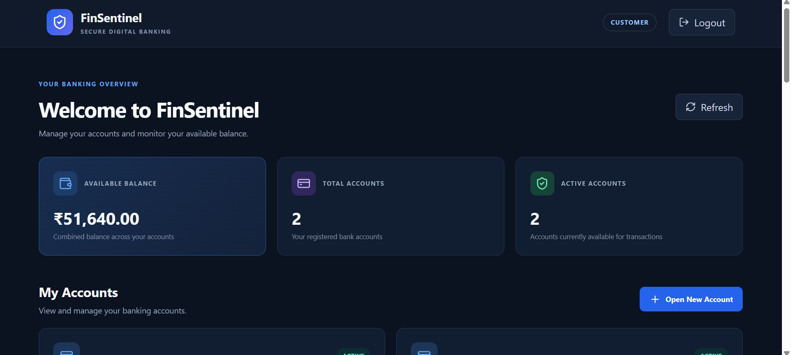
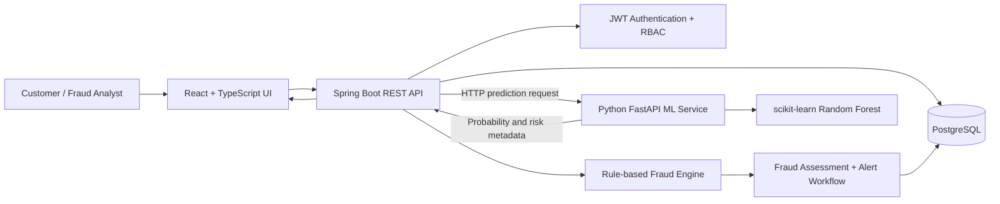

# FinSentinel — Intelligent Digital Banking & Fraud Detection Platform

<p align="center">
  <strong>A full-stack digital banking simulation with rule-based fraud assessment, an experimental machine-learning service, and an analyst review workflow.</strong>
</p>

<p align="center">
  
  
  
  
  
  
</p>

> **Project status:** Core banking simulation, fraud-rule engine, analyst workflow, dashboards, and the Spring Boot ↔ Python ML integration are implemented. Explainability enhancements, stronger ML validation, full automated hybrid coverage, container orchestration, and deployment remain future work.
>
> **Important:** FinSentinel is an educational/portfolio project. Transactions are simulated. The ML model is trained on synthetic data and is not validated for real banking or production fraud decisions.

---

## Table of contents

- [Overview](#overview)
- [Screenshots](#screenshots)
- [Key features](#key-features)
- [Architecture](#architecture)
- [Technology stack](#technology-stack)
- [Fraud detection approach](#fraud-detection-approach)
- [Machine-learning model and limitations](#machine-learning-model-and-limitations)
- [Project structure](#project-structure)
- [Run locally](#run-locally)
- [API and service URLs](#api-and-service-urls)
- [Testing](#testing)
- [Security and safety notes](#security-and-safety-notes)
- [Roadmap](#roadmap)
- [Author](#author)

## Overview

FinSentinel is a full-stack digital banking simulation designed to demonstrate how a banking application can combine everyday account operations with fraud monitoring and human review.

It contains three main applications:

1. **React frontend** — customer banking screens and an analyst workspace.
2. **Spring Boot backend** — authentication, account and transaction workflows, persistence, authorization, fraud rules, alerts, and review operations.
3. **Python ML service** — a separately hosted FastAPI service that serves predictions from a scikit-learn model.

The backend combines deterministic fraud rules with an experimental ML prediction. The rule engine remains authoritative for the transaction decision; the ML output is stored as additional context for analysts.

## Screenshots

### Sign in


### Fraud analyst dashboard


### Fraud alerts and review queue


### Fraud analytics


### Customer banking dashboard


## Key features

### Customer banking experience

- Customer registration and sign-in.
- JWT-based authentication and refresh/logout flows.
- View customer accounts and available balances.
- Simulated deposits, withdrawals, and transfers.
- Beneficiary management and beneficiary transfers.
- Transaction history and account history.
- Account freeze/unfreeze controls where authorized.

### Fraud monitoring and analyst operations

- Rule-based transaction risk scoring.
- Three possible assessment outcomes: `ALLOW`, `HOLD`, and `BLOCK`.
- Fraud alert creation for held or blocked assessments.
- Analyst assignment and alert review workflow.
- Approve or reject held transactions.
- Review history and audit-oriented records.
- Analyst workload and fraud-operation dashboard.
- Alert filtering, pagination, and CSV export.
- Fraud analytics with date-range selection and CSV/PDF report export.

### Hybrid rule + ML assessment

- Separate Python FastAPI prediction service.
- scikit-learn Random Forest model trained on generated synthetic transactions.
- Spring Boot integration with the Python service.
- ML probability, risk label, and model name/version stored with fraud assessment records.
- ML information surfaced in the analyst alert details when the API returns it.
- Rule-only fallback is retained if the ML service is unavailable.

## Architecture



### Assessment flow

1. A customer submits a simulated transaction.
2. The backend applies configured fraud rules and calculates a risk score.
3. The backend attempts to obtain an ML prediction from the Python service.
4. The rule engine determines the final `ALLOW`, `HOLD`, or `BLOCK` decision.
5. Assessment and available ML metadata are persisted.
6. Held or blocked transactions can appear in the analyst review queue.
7. An authorized analyst can review and resolve an alert.

**Decision ownership:** ML output is advisory in the current implementation. It does not independently override the existing rule-based decision.

## Technology stack

| Layer | Technologies |
|---|---|
| Frontend | React 19, TypeScript, Vite, Recharts, Lucide icons |
| Backend | Java 21, Spring Boot, Spring Security, Spring Data JPA, Maven |
| Authentication | JWT, role-based authorization |
| Database | PostgreSQL 17, Flyway migrations |
| ML service | Python 3.13, FastAPI, Uvicorn, pandas, NumPy, scikit-learn, joblib |
| Testing | JUnit / Spring Boot test suite, pytest dependencies |
| Local infrastructure | Docker (PostgreSQL container) |

## Fraud detection approach

The current deterministic rule engine includes checks such as:

| Rule | Current trigger condition |
|---|---|
| Large transaction | Transaction amount at or above ₹50,000 |
| High-risk amount pattern | Transaction amount at or above ₹100,000 |
| Multiple failed transactions | At least 3 failed transactions in the previous 24 hours |
| Rapid transactions | At least 3 transactions within 5 minutes |
| Unusual amount | Transaction is at least 3× the customer's average completed transaction amount, after sufficient history |

The configured rule scores are combined and capped at 100. The current decision bands are:

| Risk score | Decision |
|---:|---|
| 0–29 | `ALLOW` |
| 30–69 | `HOLD` |
| 70–100 | `BLOCK` |

These are project demonstration rules, not calibrated banking policies. They should be reviewed and validated before any real-world use.

## Machine-learning model and limitations

The ML service uses a Random Forest classifier and a generated dataset of approximately 20,000 synthetic transaction rows. The features include transaction amount, time, recent transaction counts, failed transaction counts, device/payee indicators, account age, geographic distance, and amount-to-average ratio.

The currently recorded evaluation at a 0.50 threshold was approximately:

| Metric | Result |
|---|---:|
| Accuracy | 0.96 |
| Fraud precision | 0.13 |
| Fraud recall | 0.13 |
| Fraud F1-score | 0.13 |
| ROC-AUC | 0.7049 |
| Average precision | 0.0761 |

**Interpretation:** Accuracy alone is misleading for this imbalanced dataset. At the recorded threshold, the model detected only a small fraction of the synthetic fraud examples. The dataset and labels are synthetic, and some production-like signals (for example, reliable device, location, and international transaction data) are not available from the current banking domain model. Therefore, the model is experimental and must not be presented as production-grade fraud detection.

The repository also contains threshold-analysis tooling to compare precision/recall trade-offs. Threshold selection should be revisited after improving the dataset, feature quality, validation methodology, and business-cost analysis.

## Project structure

```text
FinSentinel/
├── backend/
│   ├── src/main/java/com/finsentinel/
│   │   ├── ...                  # Spring Boot application modules
│   │   └── ml/                  # ML request/response, client and feature extraction
│   ├── src/main/resources/
│   │   └── db/migration/        # Flyway database migrations
│   └── mvnw.cmd                 # Maven Wrapper for Windows
├── frontend/
│   └── src/
│       ├── App.tsx
│       └── services/
├── ml-service/
│   ├── app/
│   │   ├── main.py              # FastAPI prediction API
│   │   ├── generate_dataset.py
│   │   ├── train_model.py
│   │   └── analyze_thresholds.py
│   ├── data/
│   ├── models/
│   └── requirements.txt
├── docs/
│   └── screenshots/
└── README.md
```

## Run locally

The commands below reflect the current Windows/PowerShell development setup. Open separate VS Code terminals for the ML service, backend, and frontend so all three remain running.

### Prerequisites

- Git
- Java 21
- Python 3.13
- Node.js and npm
- Docker Desktop
- PostgreSQL container configured for this project

### 1. Clone the repository

```powershell
git clone https://github.com/anurag-2705/FinSentinel.git
cd FinSentinel
```

### 2. Start PostgreSQL

The current local development container is named `finsentinel-postgres`:

```powershell
docker start finsentinel-postgres
docker ps
```

The backend is configured to connect to PostgreSQL on port `5432`. Confirm the database name, username, password, and JWT configuration in your local backend configuration. Do not commit real credentials or production secrets.

Flyway migrations are configured in the backend and are applied when the application starts.

### 3. Start the Python ML service

From the project root:

```powershell
python -m pip install -r .\ml-service\requirements.txt
python -m uvicorn app.main:app --reload --host 0.0.0.0 --port 8001 --app-dir .\ml-service
```

Check the service:

```powershell
Invoke-RestMethod http://localhost:8001/health
```

Interactive API documentation:

- `http://localhost:8001/docs`

The trained model bundle is expected at `ml-service/models/fraud_model.joblib`. If you retrain or regenerate model artifacts, review the evaluation metrics before using the model.

### 4. Start the Spring Boot backend

Open another terminal:

```powershell
cd .\backend
.\mvnw.cmd spring-boot:run
```

The backend runs at:

- `http://localhost:8080`

The ML service URL can be configured with the `ML_SERVICE_URL` environment variable. The default local value is `http://localhost:8001`.

### 5. Start the React frontend

Open another terminal:

```powershell
cd .\frontend
npm install
npm run dev
```

Open the Vite URL printed in the terminal (normally `http://localhost:5173`).

### Startup order

For the complete hybrid flow, start services in this order:

1. PostgreSQL
2. Python ML service
3. Spring Boot backend
4. React frontend

The backend retains a rule-only fallback if the ML service is unavailable, but ML fields may then be empty.

## API and service URLs

| Service | Local URL | Purpose |
|---|---|---|
| Frontend | `http://localhost:5173` | Customer and analyst UI |
| Backend | `http://localhost:8080` | Banking and fraud REST API |
| ML service | `http://localhost:8001` | ML prediction API |
| ML docs | `http://localhost:8001/docs` | Interactive FastAPI docs |
| ML health | `http://localhost:8001/health` | ML service health check |

Important implemented backend routes include the authentication, banking, fraud-alert, dashboard, and ML prediction route groups. The ML prediction endpoint is:

```http
POST /api/v1/ml/predict
```

Fraud and ML endpoints are protected by role-based authorization. Use an appropriately authorized analyst or administrator account when testing analyst operations. Do not publish test passwords, JWTs, database passwords, or signing secrets.

## Testing

Run the backend test suite:

```powershell
cd .\backend
.\mvnw.cmd clean test
```

The latest recorded full backend run completed with **36 tests, 0 failures, 0 errors, and 0 skipped**.

Check frontend TypeScript:

```powershell
cd .\frontend
npx tsc --noEmit
```

Build the frontend:

```powershell
npm run build
```

The frontend build has completed successfully in the current development state. Vite may report a large-chunk warning; this is a bundle optimization item rather than a TypeScript compilation failure.

Python test dependencies are listed in `ml-service/requirements.txt`; expand automated ML and hybrid integration coverage as the project evolves.

## Security and safety notes

- This is a local educational simulation, not a real banking service.
- Deposits and transfers do not move money through external banks or payment rails.
- Never use real customer information in the synthetic dataset or screenshots.
- Keep secrets in local environment variables or untracked configuration files.
- Use strong, unique JWT signing secrets outside local development.
- Keep analyst/admin endpoints protected by authorization checks.
- Do not rely on the current synthetic-data ML model to approve, block, or investigate real transactions.
- The current model's precision and recall are low; independent validation and substantial improvement are required.

## Roadmap

- [x] Customer and analyst frontend experiences
- [x] Authentication and role-based access control
- [x] Simulated account and transaction workflows
- [x] Fraud rules, risk scores, alerts, and analyst review
- [x] Fraud analytics dashboard and report exports
- [x] Python ML prediction service
- [x] Spring Boot ↔ Python ML integration
- [x] Persist ML metadata with fraud assessments
- [x] Display ML analysis fields in analyst alert details (frontend/API integration implemented; verify with fresh alert data)
- [ ] Explainable AI: show rule-by-rule and feature-level reasons in the review UI
- [ ] Improve data realism, model quality, and evaluation (precision/recall, PR-AUC, calibration, leakage checks)
- [ ] Add automated hybrid workflow and ML service integration tests
- [ ] Dockerize frontend, backend, ML service, and database with Docker Compose
- [ ] Add CI pipeline and deployment configuration
- [ ] Production-grade security, observability, and independent model validation

## Author

**Anurag Bhardwaj**  
B.Tech — Computer Science & Engineering (AI & ML)

GitHub: [anurag-2705](https://github.com/anurag-2705)  
Project repository: [FinSentinel](https://github.com/anurag-2705/FinSentinel)

---

<p align="center">
  Built as a learning and portfolio project to explore full-stack development, backend engineering, fraud analytics, and applied machine learning.
</p>
